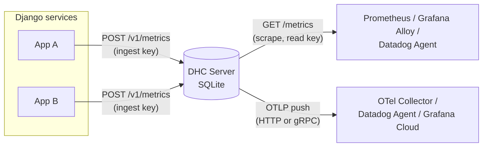

<div align="center">

# DHC Server

**Django Health Check Monitoring Server**

Collect health check results from your Django services and publish them as OpenTelemetry metrics for Prometheus, Grafana, Datadog and the OpenTelemetry Collector.

[](https://github.com/kaypee90/dhc-server/actions/workflows/ci.yml)
[](go.mod)
[](https://opentelemetry.io)
[](LICENSE)

</div>

---

## Table of contents

- [Overview](#overview)
- [Features](#features)
- [Architecture](#architecture)
- [Getting started](#getting-started)
- [Integrations](#integrations)
- [Metrics reference](#metrics-reference)
- [API reference](#api-reference)
- [Configuration](#configuration)
- [Security](#security)
- [Deployment](#deployment)
- [Development](#development)
- [Contributing](#contributing)
- [License](#license)

## Overview

DHC Server receives health check reports from the Django Health Check Monitoring library, stores them, and exposes them in the standard formats used by the observability ecosystem. It runs as a single static binary with an embedded SQLite database, with no other services required.

Use it to:

- See the current health of every check across all your Django services in one place.
- Alert when a check fails or stops reporting.
- Feed health data into the monitoring stack you already run, without custom glue code.

## Features

| | |
|---|---|
| **OpenTelemetry native** | Built on the official OpenTelemetry Go SDK, with standard resource attributes and `OTEL_*` configuration. |
| **Pull and push** | Prometheus/OpenMetrics scrape endpoint and OTLP export over HTTP or gRPC. They can run at the same time. |
| **Secure by default** | API key authentication is required, with separate write and read keys, rate limiting, input validation, cardinality limits and optional TLS. |
| **Lightweight** | One static binary in a distroless, non-root container image. Pure-Go SQLite, no cgo. |
| **Operable** | Structured JSON logs, graceful shutdown with metric flush, optional data retention, and a liveness endpoint. |

## Architecture



Each report is stored in SQLite. When a scraper or the OTLP exporter collects metrics, the server reads the latest value of every `(source, check)` pair from the database. So scrape and push always reflect the most recent state, and that state survives restarts.

## Getting started

### Prerequisites

- Go 1.26 or later, **or** Docker

### Run locally

```sh
git clone https://github.com/kaypee90/dhc-server.git
cd dhc-server

# One key for Django services (write) and one for scrapers (read).
export DHC_INGEST_API_KEYS=$(openssl rand -hex 32)
export DHC_READ_API_KEYS=$(openssl rand -hex 32)

go run .
```

The server listens on `http://localhost:8080`.

### Send a report

```sh
curl -X POST http://localhost:8080/v1/metrics \
  -H "Authorization: Bearer $DHC_INGEST_API_KEYS" \
  -H "Content-Type: application/json" \
  -d '{"label": "DatabaseBackend", "value": 0, "description": "working", "source": "web"}'
```

In your Django services, configure the Health Check Monitoring library to send reports to `POST /v1/metrics` with an ingest key in the `Authorization: Bearer` (or `X-API-Key`) header.

### Read the metrics

```sh
curl -H "Authorization: Bearer $DHC_READ_API_KEYS" http://localhost:8080/metrics
```

```text
# HELP dhc_health_check_status Latest value reported by each Django health check.
# TYPE dhc_health_check_status gauge
dhc_health_check_status{check="DatabaseBackend",source="web",...} 0
```

## Integrations

Ready-to-use configuration files are in [`examples/`](examples).

| Backend | Pull: scrape `/metrics` | Push: OTLP |
|---|---|---|
| **Prometheus** | [`examples/prometheus.yml`](examples/prometheus.yml) | Through the Collector, or Prometheus's OTLP receiver (`--web.enable-otlp-receiver`) |
| **Grafana** | Prometheus data source, or Grafana Alloy `prometheus.scrape` | Grafana Cloud OTLP gateway |
| **Datadog** | Agent OpenMetrics check: [`examples/datadog-openmetrics.yaml`](examples/datadog-openmetrics.yaml) | Agent OTLP intake |
| **OpenTelemetry Collector** | `prometheus` receiver | `otlp` receiver: [`examples/otel-collector.yaml`](examples/otel-collector.yaml) |

Alerting rules for failing and stale checks are in [`examples/alerts.yml`](examples/alerts.yml).

### Prometheus

```yaml
scrape_configs:
  - job_name: dhc-server
    static_configs:
      - targets: ["dhc-server:8080"]
    authorization:
      type: Bearer
      credentials_file: /etc/prometheus/dhc-read-key
```

### OpenTelemetry Collector

```sh
OTEL_EXPORTER_OTLP_ENDPOINT=http://otel-collector:4318
```

For gRPC, also set `OTEL_EXPORTER_OTLP_PROTOCOL=grpc` and point the endpoint at port `4317`.

### Datadog

Push to the Datadog Agent's OTLP intake:

```sh
OTEL_EXPORTER_OTLP_ENDPOINT=http://datadog-agent:4318
OTEL_EXPORTER_OTLP_METRICS_TEMPORALITY_PREFERENCE=delta
```

Or let the Agent scrape `/metrics` with the OpenMetrics check (see the example file).

### Grafana Cloud

```sh
OTEL_EXPORTER_OTLP_ENDPOINT=https://otlp-gateway-<region>.grafana.net/otlp
OTEL_EXPORTER_OTLP_HEADERS=Authorization=Basic%20<base64 instance-id:token>
```

### Supported OpenTelemetry variables

OTLP export turns on when `OTEL_EXPORTER_OTLP_ENDPOINT` or `OTEL_EXPORTER_OTLP_METRICS_ENDPOINT` is set.

| Variable | Notes |
|---|---|
| `OTEL_METRICS_EXPORTER` | Comma-separated `otlp`, `prometheus`, `none`. Overrides automatic detection and `DHC_PROMETHEUS_ENABLED`. |
| `OTEL_SDK_DISABLED` | `true` turns off all metric export. |
| `OTEL_EXPORTER_OTLP_[METRICS_]PROTOCOL` | `http/protobuf` (default) or `grpc`. `http/json` is not supported. |
| `OTEL_EXPORTER_OTLP_[METRICS_]ENDPOINT` | Collector or backend address. |
| `OTEL_EXPORTER_OTLP_[METRICS_]HEADERS` | Comma-separated `key=value` pairs, URL-encoded (`Basic%20<token>`). |
| `OTEL_EXPORTER_OTLP_[METRICS_]TIMEOUT`, `_COMPRESSION`, `_INSECURE` | Transport options. |
| `OTEL_EXPORTER_OTLP_[METRICS_]CERTIFICATE`, `_CLIENT_CERTIFICATE`, `_CLIENT_KEY` | TLS and mTLS to the collector. |
| `OTEL_EXPORTER_OTLP_METRICS_TEMPORALITY_PREFERENCE` | `cumulative` (default), `delta` or `lowmemory`. |
| `OTEL_METRIC_EXPORT_INTERVAL`, `OTEL_METRIC_EXPORT_TIMEOUT` | Push interval and timeout, in milliseconds. |
| `OTEL_SERVICE_NAME`, `OTEL_RESOURCE_ATTRIBUTES` | Override or extend resource attributes. |

Pending metrics are flushed on shutdown.

## Metrics reference

| OpenTelemetry name | Prometheus name | Type | Attributes | Description |
|---|---|---|---|---|
| `dhc.health_check.status` | `dhc_health_check_status` | Gauge | `source`, `check` | Latest value reported by each check. |
| `dhc.health_check.last_report_time` | `dhc_health_check_last_report_time_seconds` | Gauge | `source`, `check` | Unix time of the latest report. Use it to detect checks that stopped reporting. |
| `dhc.health_check.reports` | `dhc_health_check_reports_total` | Counter | none | Reports received since the server started. |

- `source` is the reporting service and `check` is the report's `label`.
- The counter has no per-check attributes on purpose. A cumulative counter never drops an attribute set, so it would grow without bound as checks come and go.
- Resource attributes: `service.name=dhc-server`, `service.version`, and the OpenTelemetry SDK attributes.

**Example alerts (PromQL)**

```promql
# A check is failing
dhc_health_check_status != 0

# A check has not reported in 15 minutes
time() - dhc_health_check_last_report_time_seconds > 900
```

## API reference

All endpoints except the liveness check need an API key, sent as `Authorization: Bearer <key>` or `X-API-Key: <key>`. If an `Authorization` header is present but isn't a Bearer token, the request is rejected; it does not fall back to `X-API-Key`.

| Method | Path | Key | Description |
|---|---|---|---|
| `GET` | `/v1/` | none | Liveness check. Returns `503` if the database is unreachable. |
| `POST` | `/v1/metrics` | ingest | Store a health check report. |
| `GET` | `/v1/metrics` | read or ingest | Stored reports grouped by source, newest first. `?limit=` 1–10000, default 1000. |
| `GET` | `/v1/metrics/latest` | read or ingest | Latest report for each source/check pair. |
| `GET` | `/v1/metrics/summary` | read or ingest | Number of reports for each `(label, value)` pair. |
| `GET` | `/metrics` | read or ingest | Prometheus/OpenMetrics scrape endpoint. |

### `POST /v1/metrics`

```json
{
  "label": "DatabaseBackend",
  "value": 0,
  "description": "working",
  "source": "web"
}
```

| Field | Type | Rules |
|---|---|---|
| `label` | string | Required, 1–128 characters, printable text |
| `value` | integer | Required; `0` is valid |
| `description` | string | Required, up to 1024 characters, printable text |
| `source` | string | Required, 1–128 characters, printable text |

"Printable text" excludes control characters and invisible characters such as zero-width spaces, bidi overrides and line separators. This prevents look-alike series in dashboards.

| Status | Meaning |
|---|---|
| `201 Created` | Report stored; the response body is the stored record. |
| `400 Bad Request` | Invalid JSON or validation failure. |
| `401 Unauthorized` | Missing or invalid ingest key. |
| `413 Payload Too Large` | Body larger than `DHC_MAX_BODY_BYTES`. |
| `422 Unprocessable Entity` | The report would create a new source/check pair beyond `DHC_MAX_SERIES`. |
| `429 Too Many Requests` | Rate limit exceeded (unauthenticated requests only). |

### `GET /v1/metrics/latest`

```json
{
  "data": [
    { "source": "web", "label": "DatabaseBackend", "value": 0, "reported_at": "2026-11-03T20:31:32.477826Z" }
  ]
}
```

## Configuration

All settings are environment variables.

### Core

| Variable | Default | Description |
|---|---|---|
| `DHC_ADDR` | `:8080` | Listen address. |
| `DHC_DATABASE_PATH` | `dhc.db` | SQLite database file. |
| `DHC_RETENTION_PERIOD` | `0` (keep forever) | How long to keep reports, as a Go duration (for example `720h`). Recommended in production. |
| `DHC_PROMETHEUS_ENABLED` | `true` | Serve the `/metrics` scrape endpoint. |

### Authentication

| Variable | Default | Description |
|---|---|---|
| `DHC_INGEST_API_KEYS` | **required** | Comma-separated keys allowed to submit reports (and read). At least 32 characters each. |
| `DHC_READ_API_KEYS` | none | Comma-separated keys allowed only to read. At least 32 characters each. |
| `DHC_AUTH_DISABLED` | `false` | Turn off authentication. **Local development only.** |

Generate a key with `openssl rand -hex 32`. To rotate a key, list the old and new keys together, update your clients, then remove the old key.

### Network and limits

| Variable | Default | Description |
|---|---|---|
| `DHC_TLS_CERT_FILE`, `DHC_TLS_KEY_FILE` | none | Serve HTTPS (TLS 1.2+). Set both. |
| `DHC_TRUSTED_PROXIES` | none | Proxy IPs/CIDRs whose `X-Forwarded-For` header is trusted. |
| `DHC_CORS_ALLOWED_ORIGINS` | none | Browser origins allowed to call the API, including the scheme (`https://dash.example.com`). |
| `DHC_RATE_LIMIT_RPS` | `10` | Requests per second per client for unauthenticated requests. `0` disables. |
| `DHC_RATE_LIMIT_BURST` | `20` | Burst size. Must be at least 1 when rate limiting is on. |
| `DHC_MAX_BODY_BYTES` | `65536` | Largest accepted request body. |
| `DHC_MAX_SERIES` | `1000` | Maximum number of distinct source/check pairs. |

The server checks its configuration at startup and exits with a clear message if anything is invalid.

## Security

| Area | Protection |
|---|---|
| **Authentication** | The server won't start without ingest keys. Keys are compared in constant time. Write and read keys are separate, so a scraper's credentials can't submit data. |
| **Abuse** | Unauthenticated requests are rate limited per client IP, with IPv6 grouped by /64 and the tracking table bounded. Requests with a valid key are not rate limited, so anonymous traffic can't block your services. |
| **Proxies** | `X-Forwarded-For` is ignored unless the request comes from `DHC_TRUSTED_PROXIES`, so clients can't spoof their address. |
| **Input** | Request body size limit, field length limits, printable-text validation, and a cap on distinct series to protect metric backends from cardinality explosions. |
| **Transport** | Optional built-in TLS 1.2+, or terminate TLS at your load balancer. HSTS is sent when TLS is on. |
| **HTTP hardening** | Read, write and idle timeouts, header size limit, `nosniff`, `X-Frame-Options`, a restrictive CSP, `no-store` caching, and CORS off by default. |
| **Information leakage** | Internal errors are never returned to clients. Logs record route, status, latency and client IP, never headers or keys. |
| **Container** | Static binary on distroless, running as a non-root user. `.dockerignore` keeps local databases and secrets out of the image. |

> **Behind a load balancer or ingress**, set `DHC_TRUSTED_PROXIES` to its address range. Otherwise every unauthenticated client, including health probes, shares the proxy's single rate-limit bucket.

To report a vulnerability, please open a private security advisory on GitHub rather than a public issue.

## Deployment

### Docker

```sh
docker build -t dhc-server .

docker run -d --name dhc-server \
  -p 8080:8080 \
  -v dhc-data:/data \
  -e DHC_INGEST_API_KEYS="$DHC_INGEST_API_KEYS" \
  -e DHC_READ_API_KEYS="$DHC_READ_API_KEYS" \
  -e DHC_RETENTION_PERIOD=720h \
  dhc-server
```

The database is stored at `/data/dhc.db`. The container runs as UID/GID `65532`:

- **Named volumes** get the right ownership automatically.
- **Bind mounts:** run `chown 65532:65532` on the host directory.
- **Kubernetes:** set `securityContext.fsGroup: 65532`.

### Production checklist

- [ ] Set distinct ingest and read keys, and store them in a secret manager.
- [ ] Turn on TLS, or run behind a TLS-terminating proxy.
- [ ] Set `DHC_TRUSTED_PROXIES` if you run behind a proxy.
- [ ] Set `DHC_RETENTION_PERIOD`.
- [ ] Put `/data` on persistent storage.
- [ ] Use `GET /v1/` for liveness and readiness probes.
- [ ] Load the alert rules from [`examples/alerts.yml`](examples/alerts.yml).

## Development

```sh
make test        # tests with the race detector
make lint        # go vet
make vuln        # govulncheck
make build       # static binary for the current platform
make build-linux # static linux/amd64 binary
make docker      # container image
```

Run with hot reload (authentication disabled):

```sh
DHC_AUTH_DISABLED=true air -c .air.toml
```

### Project structure

```text
.
├── main.go          # Wiring, HTTP server, graceful shutdown, retention job
├── config.go        # Environment configuration and validation
├── handlers.go      # /v1 HTTP handlers
├── dal.go           # Data model and SQLite access
├── telemetry.go     # OpenTelemetry meter provider, Prometheus and OTLP exporters
├── security.go      # Authentication, rate limiting, headers, input validation
├── logging/         # Structured logging (zap)
├── examples/        # Prometheus, Collector, Datadog and alerting configs
└── main_test.go     # Tests
```

Continuous integration runs vet, race-enabled tests, a static build, govulncheck and a Docker build on every push and pull request.

## Contributing

Contributions are welcome.

1. Fork the repository and create a feature branch.
2. Make your change, with tests.
3. Run `make lint test`.
4. Open a pull request with a clear description of the change.

Please use [GitHub issues](https://github.com/kaypee90/dhc-server/issues) for bug reports and feature requests.

## License

Released under the [MIT License](LICENSE).
